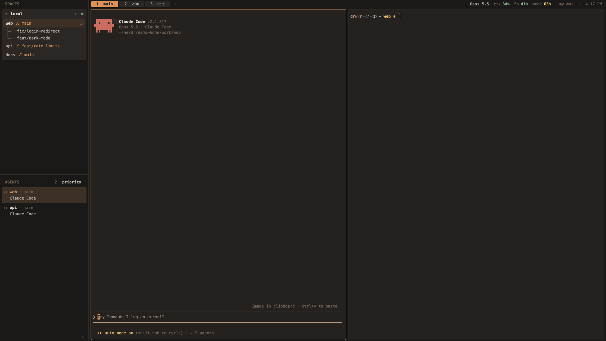

# herdr-tui-layout

**herdr-tui's look and keys, inside herdr-app.**
Spaces by machine with their branches and worktrees, your agents under them,
one thin line of tabs on top, and the `ctrl-b` keys your hands already know.




A community layout for the [Herdr](https://herdr.dev) desktop app
(**herdr-app**). It is not herdr-tui, the terminal app, and it is not made by
Herdr.

- **The sidebar you're used to.** One rounded block per machine (`Local`,
  your SSH machines), each space on one line with its branch in orange
  (`web ⎇ main`), worktrees drawn as a little tree under their repo,
  and the tab count at the right. Fold a machine with a click; drag spaces to
  reorder them.
- **Agents under the spaces,** the way herdr-tui lists them: a status mark,
  the space and tab, and what the agent is doing. Sort by `priority` (who
  needs you first) or by `spaces`, and drag the divider between the halves.
- **One line on top.** Numbered tabs (drag to reorder, double-click to
  rename), the focused agent's model and context, your Claude 5-hour and
  weekly use with reset times on hover, and the machine and time, like
  herdr-tui's `tab_bar_right`.
- **`ctrl-b` keys.** New tab, split, zoom, move between panes, jump to a
  space or agent by number, new worktree, rename, the picker, and lazygit,
  btop and yazi in floating terminals.
- **Folds to a strip.** `«` turns the sidebar into a 40px rail of space
  numbers and agent letters with their status, `»` brings it back.
- **Machines that drop.** A remote machine shows green, `◐ reconnecting`, or
  red `unreachable`, and a folded machine still shows the most urgent agent
  inside it.
- **Melange**, a warm coffee-brown palette, and Menlo at one size everywhere,
  terminals and panels alike.
- **Rounded popups that fit.** Right-click menus, rename, the worktree
  dialog, the picker, help and `+` draw their own rounded boxes, so their
  corners don't show the notch Herdr's stock dialogs have.

## Try it in two minutes

You need:

- **herdr-app** (the Herdr desktop app) 0.1.12 or newer, with herdr-core
  (`hc`). Built and tested on macOS 27 with herdr-app 0.1.12 and hc 0.1.17.
- Optional: lazygit, btop and yazi for the popup keys; Claude Code for the
  usage numbers.

### The easy way: ask your agent

In a Herdr terminal, ask your coding agent:

> Add the layout herdr.dev/layouts/VedangP57/herdr-tui-layout

Herdr's agent guide (`~/.config/herdr-app/AGENTS.md`) tells it how: read every
file, copy the layout, mods and theme into place, merge `keys.json`, check
each mod and switch to it.

### The script way

```sh
git clone https://github.com/VedangP57/herdr-tui-layout.git
cd herdr-tui-layout
./scripts/install.sh               # add --usage-hook for the Claude numbers
```

It copies `layouts/`, `themes/` and `mods/` into `~/.config/herdr-app`
(or `$HERDR_APP_HOME`), adds the layout's keys to `keys.json`, runs
`herdr-app check` on every mod, and switches to the layout. It never
overwrites anything without `--force`, and `--force` moves the old copy to
`~/.config/herdr-app/backups/` first. `keys.json` is backed up there too.

**Switch back any time** with `ctrl-shift-l`, or in Settings → Look.

## Keys

All on the `ctrl-b` prefix, and only while this layout is showing
(`keys.json`, section `layout:herdr-tui-layout`):

| Keys | Does |
|---|---|
| `c` · `n` · `p` | new tab · next tab · previous tab |
| `1`…`9` | tab 1–9 |
| `shift-x` · `shift-t` | close tab · rename tab |
| `shift-1`…`shift-9` | space 1–9 |
| `shift-n` · `shift-w` · `shift-d` | new space · rename space · close space |
| `w` | picker (spaces and tabs) |
| `shift-g` | new worktree of this space's repo |
| `v` · `minus` | split right · split down |
| `x` · `z` | close pane · zoom |
| `h` `j` `k` `l` | go to the pane left · down · up · right |
| `alt-1`…`alt-9` | the agent in that row |
| `b` | sidebar on and off |
| `alt-g` · `alt-b` · `alt-f` | lazygit · btop · yazi, floating; closes when the program quits |
| `shift-/` · `s` | help · settings |

Herdr's own `cmd` keys keep working alongside.

## Mouse

- **Space:** click to show it; drag onto another space of the same machine
  to move it; right-click for Rename, New / Open / Remove worktree, Close.
- **Machine row:** click to fold or unfold; `+` starts a space there.
- **Tab:** click to show, double-click to rename, drag onto another tab to
  move it.
- **Agent row:** click to go to that agent.
- **Terminal:** right-click for split, zoom and close.
- **`«` / `»`:** fold the sidebar to a strip and back.
- **`priority` / `spaces`:** switch how agents are sorted.

## The usage numbers (optional)

The top line can show `Opus 5.5  ctx 34%  5h 41%  week 63%`: the focused
agent's model and how full its context is, then your Claude 5-hour and weekly
limits (green, yellow from 50%, red from 80%; hover for when each resets).

Claude Code only shares those numbers with its **status-line command**, so
the layout ships one: `extras/claude-usage-hook.sh`. It saves the JSON Claude
Code hands it to `~/.local/state/herdr-tui-layout/claude/<session>.json` and
**prints nothing**, so Claude Code's own bottom bar doesn't change.

- `./scripts/install.sh --usage-hook` installs it and sets
  `"statusLine"` in `~/.claude/settings.json` (backed up first). If you
  already have a status line, it leaves yours alone and tells you.
- It applies to every Claude Code session on the machine, started after it
  is set.
- Without it, the top line simply leaves the numbers out.

## How herdr-tui maps onto herdr-app

| herdr-tui | herdr-tui-layout |
|---|---|
| workspaces | spaces, grouped by machine |
| `prefix` + keys | `ctrl-b` + the same letters |
| agents sidebar, `priority` | agents half of the sidebar, `priority` / `spaces` |
| `tab_bar_right` hostname · time | top line, right |
| worktree tree under a repo | the same, drawn |
| popup keys (lazygit …) | floating terminals on `alt-g/b/f` |
| agent-quota sidebar rows | the usage numbers in the top line |
| machines (`vps`, …) | one block per machine, with its connection state |

Not carried over: link handlers (clicking a file path in terminal output);
herdr-app doesn't let layouts make terminal text clickable.

## What it runs

The guide asks layouts to say this up front. herdr-tui-layout:

- runs `hostname -s` and `hc machine ls --json` (to name and check machines),
  `git` (in the worktree dialog), `sh`, `ls` and `stat` over
  `~/.local/state/herdr-tui-layout/claude/` (the usage numbers), and
  lazygit, btop or yazi when you press their keys;
- reads only that usage folder outside its own;
- makes no network requests.

## Troubleshooting

- **A panel shows "This view could not be rendered".** Run
  `herdr-app check ~/.config/herdr-app/mods/<that mod>` and open an issue
  with its output.
- **The tabs look cut off at the bottom.** A dragged boundary is saved in
  `~/.config/herdr-app/layouts/.state/herdr-tui-layout.json` and beats the
  layout file. The top line can't be dragged in this layout; if an older
  state remains, run `herdr-app do layout.resize --id tabs --px 26`.
- **"Too many open files" when opening tabs.** herdr-core keeps every
  terminal open in one background process, and macOS's default 256-file
  limit allows about 80 terminals. Raise it with
  `sudo launchctl limit maxfiles 65536 200000`, then log out and back in.
- **The corners of the terminal right-click menu and the close-confirm
  dialog are Herdr's.** The app opens those itself, so the layout can't give
  them its own box.
- **Your keys do nothing.** They only apply while this layout is shown, and
  `ctrl-b` must reach the app, not a terminal program that grabs it first.

## Update and uninstall

- **Update:** `git pull`, then `./scripts/install.sh --force`.
- **Uninstall:** switch to another layout, then delete
  `layouts/herdr-tui-layout.json` and `.png`, `themes/herdr-tui-layout.json`,
  the `mods/herdr-tui-layout-*` folders and the `layout:herdr-tui-layout`
  section of `keys.json` in `~/.config/herdr-app`. If you installed the
  usage hook, remove `statusLine` from `~/.claude/settings.json`.

## Known limits

- Tested on macOS only. The popup and picker sizes assume a 16:9 window.
- Not yet tried on screen: the `ctrl-b` keys, the popups, the picker, help,
  the `+` menu and the reconnecting state. Each loads and type-checks;
  reports welcome.
- `ctrl-b` is taken from programs while the layout shows (a shell loses
  ctrl-b for back-a-character).
- Worktree nesting goes by folder: a space under
  `~/.herdr/worktrees/<repo>/` nests under the space whose folder is named
  `<repo>`.

## How it's built

```
layouts/herdr-tui-layout.json   the window: top line, sidebar (two halves), panes
themes/herdr-tui-layout.json    Melange
mods/herdr-tui-layout-side      the sidebar: spaces, worktrees, agents, the fold strip
mods/herdr-tui-layout-bar       the top line: tabs, usage, machine and time, popups
mods/herdr-tui-layout-menu      right-click menus          ┐
mods/herdr-tui-layout-prompt    rename                     │ modified copies of
mods/herdr-tui-layout-worktree  new / open / remove        │ Herdr's own mods,
mods/herdr-tui-layout-new-menu  the + menu                 │ each drawing its own
mods/herdr-tui-layout-picker    the picker                 │ rounded box
mods/herdr-tui-layout-help      help                       ┘
keys.json                       the ctrl-b keys
extras/claude-usage-hook.sh     optional Claude Code statusLine
scripts/install.sh              the installer
RECIPE.md                       the brief an agent can rebuild it from
```

`RECIPE.md` has the full picture: every region's size and colour, every
behaviour, the layout tree, and what tripped the build up.

## Contributing

Bug reports and ideas are welcome: open an issue with a screenshot and, for
a broken panel, the `herdr-app check` output. Before a change, check each mod
with `herdr-app check` and type-check it against the `gpui-kit.d.ts` Herdr
writes beside it: `herdr-app check` renders once without agents, so an error
in an agent row slips past it.

## License and credits

Apache-2.0 (see `LICENSE`). Six mods are modified copies of mods shipped
with the Herdr app, which is Apache-2.0; `NOTICE` lists them and each says
what changed. The colours are [Melange](https://github.com/savq/melange-nvim)
by savq. Not affiliated with Herdr.

## Why the name

herdr-tui is what the terminal herdr is called now; this is a layout that
makes herdr-app feel like it. Hence herdr-tui-*layout*.
