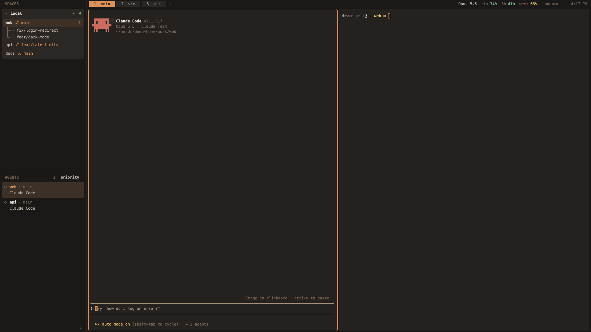

# herdr-tui-layout

herdr-tui's look and keys (the terminal herdr), inside herdr-app. A dark coffee-brown
window in Menlo 12.5: on the left, your spaces grouped by machine, each on one
line with its git branch and its worktrees on a little tree under it, and your
agents under them; across the top, one thin line of numbered tabs, the
focused agent's model and context, your Claude 5-hour and weekly use, and the
machine and time. Panes are rounded cards with a 1px border that turns orange
on the one you're typing in. `ctrl-b` drives it like herdr-tui does.
A community layout for herdr-app, not herdr-tui itself; not affiliated with Herdr.

## What you see

The theme is Melange (`themes/herdr-tui-layout.json`): terminal `#292522` on
`#ECE1D7`; bars and sidebar `#1d1a18`; blocks, tabs and dialogs `#302c28`;
hover `#3b3531`; selected `#47382b`; borders `#37322f`; accent `#E49B5D`;
dim text `#867462`. Status colours: working `#EBC06D`, needs you `#D47766`,
done `#85B695`, idle `#867462`. Every font is Menlo at 12.5px, terminals and
panels alike; emphasis is bold or dim, never a bigger size.

Top to bottom:

1. **Top line, 26px, across the whole window.** No line under it.
   - Over the sidebar, the same width as the sidebar: `SPACES` in bold dim
     caps, and the sidebar's divider carried up through the bar to the top.
     Outside fullscreen it leaves 80px for the macOS window buttons.
   - The shown space's tabs as pills, 20px tall, at least 64px wide, numbers
     centred (a named tab shows `2  vim`). The active tab is solid orange with
     dark bold text; the rest `#302c28`. A tab whose agent is working, done
     or needs you shows a 6px dot in that colour. Then a `+`.
   - On the right: the focused agent's model (`Opus 5.5`), `ctx 11%`, `5h 12%`,
     `week 13%` (each number green, yellow from 50%, red from 80%; hovering
     5h or week shows when it resets), then the machine the shown space runs
     on (this Mac's short hostname, or a remote machine's own hostname) and
     the time, `my-mac  ·  3:10 PM`.
2. **Body**, a row: the sidebar (280px, 40–480px, drag its edge) and the
   panes, 1px `#37322f` divider between.
3. **Sidebar, top half: spaces.** One rounded `#302c28` block per machine,
   6px apart.
   - The block's first row is the machine: `▾ Local` (this Mac) or its name,
     bold; `+` to start a space there; a 7px dot, green connected, yellow
     with `◐ reconnecting`, red with `unreachable`. Click the row to fold the
     machine to `▸`; folded, it shows the most urgent agent status inside it.
   - Then one line per space: its name (bold and on a `#47382b` background
     when shown, cut at 150px), its branch in orange as `⎇ main` (or its
     folder, dim, when it has no branch and the folder isn't its name), and
     its tab count at the right when it has more than one tab.
   - A worktree space sits under its repo's space on a drawn tree: a 1px
     trunk and a 10px twig, the trunk stopping halfway on the last one, then
     a status mark and its branch. An orange `▾` at the right end of the
     repo's row folds them to `▸`.
   - Under the same repo's space, its local branches as a second drawn tree:
     one line each, the checked-out branch in accent and the rest muted.
     Clicking one goes to that branch's worktree space (a shell starts in a
     bare one), or opens the worktree dialog to create it when it has none;
     a `main` / `master` nobody is in stays a muted label and does nothing.
   - Which repo: git, asked in each space's live folder (its first
     terminal's `cwd`, else its folder) every 15s: a space is a worktree when
     `--git-common-dir` isn't its `--show-toplevel`'s `.git`, and it nests
     under the space holding that repo's main checkout.
4. **Sidebar, bottom half: agents.** A draggable divider between the halves.
   - Heading `AGENTS` with how many there are (or `2 need you` in red), and
     a `priority` / `spaces` switch.
   - One row per agent: `●` / `○` / `·` in its status colour, the space name
     bold, `· <tab name or number>` dim; under it, what the agent's terminal
     is titled (Claude's current task), muted. The agent you're in is on
     `#47382b` with its name orange; one that needs you is tinted red.
   - Under an agent, its live workers: terminals reporting to its address, one
     line each on the same tree, behind `▾`/`▸` with how many there are.
     Clicking one peeks that terminal. A live status terminal with no parent
     counts as its folder's agent's worker; whatever no folder claims folds
     under one row at the end.
   - `«` at the bottom right folds the sidebar.
5. **Folded sidebar, 40px.** Spaces as their number on their machine with a
   status mark (`1○ 2· 3●`), other machines opening with `▾2`, `▾3`; the
   shown space highlighted; agents below a line as their space's first
   letter with a mark; `»` at the bottom opens it again at its last width.
6. **Panes:** cards with 6px corners and 6px gaps, no header line, terminal
   padding 6×10. 3px between the top line and the panes, and at the window's
   bottom.
7. **Popups and dialogs** (right-click menus, rename, worktree, `+`, picker,
   help) draw their own `#302c28` box with 10px corners and a 1px border;
   the selected row is `#47382b` and follows the pointer.

## How it behaves

- **Agent status** comes from the agents themselves (Claude Code reports it):
  working is yellow, done green, needs you red, idle a ring. In `priority`
  order, agents needing you come first, then done, working, idle; in
  `spaces` order they follow the spaces list. `ctrl-b alt-1..9` jumps to the
  agent in that row.
- **Clicks:** a space switches to it; dragging a space onto another of the
  same machine moves it (it fades; an orange line shows where it lands);
  right-click a space for Rename, New / Open / Remove worktree, Close. A tab
  selects; double-click renames; drag a tab onto another to move it. An agent
  row goes to that agent. Right-click a terminal for split, zoom, close.
- **Keys** (`keys.json`, only while this layout shows; prefix `ctrl-b`):
  `c` new tab, `n` / `p` next / previous, `shift-x` close tab,
  `shift-t` rename tab; `shift-1..9` space N, `shift-n` new space,
  `shift-w` rename space, `shift-d` close space, `w` picker, `shift-g` new
  worktree; `v` split right, `minus` split down, `x` close pane, `z` zoom,
  `h j k l` move between panes; `b` sidebar; `shift-/` help; `s` settings;
  `alt-g` lazygit, `alt-b` btop, `alt-f` yazi, each in a floating terminal
  (80% / 90% of the window) that closes when the program exits.
- The top line's numbers refresh every 15s; machine states and hostnames
  every 10s and 60s; the clock every 15s.

## Built from

- **Layout** (`layouts/herdr-tui-layout.json`): a column (`"resizable": false`, so
  the top line can't be dragged), `titlebar: "none"`, `traffic_lights`
  `[14, 14]`, `terminal_menu: "herdr-tui-layout-menu"`, `background: "chrome"`.
  Children: `tabs` (block, 26px, `herdr-tui-layout-bar`, `window_drag`) and `body`
  (row): `sidebar` (column, 280px, 40–480) holding `side-spaces` and
  `side-agents` (blocks, weight 1, min 80, both `herdr-tui-layout-side` with
  `props.part` `"spaces"` / `"agents"`), and `main` (block, padding
  `[3, 6]`, `{ tab: "active" }` with pane frames: gap 6, radius 6, border
  `border`, focus `accent`, `lone: true`, no header).
- **herdr-tui-layout-side:** `spaces()`, `agents()`, `machines()`, `terminals()`, `setAgentOrder`,
  `space.select`, `space.move`, `space.new`, `pane.focus`, `layout.resize`
  (fold to 40, unfold to the width it had, kept in `localStorage`),
  `openOverlay`; polls `hc machine ls --json` for connection states; listens
  on `nextCommand()` for `agent-N`, `rename-space`, `new-worktree`.
- **herdr-tui-layout-bar:** `spaces()`, `layout()` (to match the sidebar's width),
  `window()`, `focused()`, `tab.select`, `tab.move`, `openOverlay`; runs
  `hostname -s`, `hc machine ls --json`, and a `sh` loop reading
  `~/.local/state/herdr-tui-layout/claude/*.json`; starts popups with
  `hc run --bg --rm` and shows them as dialog overlays holding the terminal;
  listens for `popup-lazygit|btop|yazi`, `rename-tab`, `picker`, `help`.
- **Copies of Herdr's mods** (Apache-2.0, see NOTICE), each opened with
  `frame: "none"` and drawing its own rounded box: `herdr-tui-layout-menu` (`menu`),
  `herdr-tui-layout-prompt` (`prompt`), `herdr-tui-layout-worktree` (`worktree`),
  `herdr-tui-layout-new-menu` (`new-menu`), `herdr-tui-layout-picker` (`picker`),
  `herdr-tui-layout-help` (`help`).
- **extras/claude-usage-hook.sh**, optional: a Claude Code `statusLine`
  command that saves each session's status JSON to
  `~/.local/state/herdr-tui-layout/claude/<session_id>.json` and prints nothing.
  Install it with `"statusLine": {"type": "command", "command":
  "<path>/claude-usage-hook.sh"}` in `~/.claude/settings.json`.

## Watch out

- **What it runs and reads:** `hostname`, `hc machine ls`, `git rev-parse`, `git for-each-ref refs/heads` and `git worktree list --porcelain` in each space's folder every 15s (to nest worktrees and list branches), and `git` in the worktree dialog, `sh`/`ls`/`stat` over `~/.local/state/herdr-tui-layout/claude/`,
  and lazygit/btop/yazi on their keys. No network.
- **Without the usage hook** the top line just leaves model, ctx, 5h and
  week out. The hook applies to every Claude Code session on the machine.
- **Square-in-rounded corners:** Herdr's own dialogs paint a square
  background inside the app's slightly rounded frame, and the corners show a
  notch. That's why six mods are copies opened with `frame: "none"`. The
  terminal right-click menu and the close-confirm dialog are opened by the
  app itself, which ignores that, so they keep Herdr's small corners;
  `popover` in the theme matches the frame so they stay clean.
- **`herdr-app check` alone isn't enough:** it renders once without agents,
  so a bad style call in an agent row passes it. Type-check against the
  mod's `gpui-kit.d.ts` too (`line_clamp` doesn't exist; `flex_shrink()`
  needs a number), and look at the window: `line_height(15)` is fifteen
  times the text size, not 15px.
- **Saved drags beat the file:** a dragged boundary is kept in
  `layouts/.state/` and overrides `layouts/herdr-tui-layout.json`.
- **Worktree nesting** asks git, never names: a space's `folder` can be
  stale (where it was made) and its name can be anything. An earlier build
  matched folder names and put one repo's worktree under another repo.
- **`ctrl-b`** is taken from programs while this layout shows (shells lose
  ctrl-b for back-a-character).
- The picker's height assumes a 16:9 window. Popup sizes do too.
- Untested on screen so far: the `ctrl-b` keys, the popups, the picker, help,
  the `+` menu, and the reconnecting state; each loads and type-checks.

## Done when

- With the layout shown, the window has no title bar; the top line is 26px
  with `SPACES` over the sidebar and the line between sidebar and panes runs
  to the top.
- Spaces show grouped by machine on `#302c28` blocks, one line each, with
  worktrees on a drawn tree under their repo; clicking `▾ Local` folds it.
- Dragging a space onto another moves it; dragging tab 2 onto tab 1 swaps
  them.
- `«` folds the sidebar to a 40px strip of numbers and letters; `»` restores
  its width.
- `ctrl-b c` opens a tab; `ctrl-b alt-g` opens lazygit floating over the
  tab, gone when it quits.
- Right-click a space → Rename opens a dialog with 10px corners and no notch.
- With the usage hook installed and a Claude session running, the top line
  shows its model and ctx, and 5h and week turn yellow past 50%.
- Every mod passes `herdr-app check`, and a TypeScript check against its
  `gpui-kit.d.ts` shows no errors the mod's Herdr original doesn't have.
